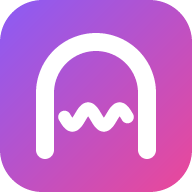

<p align="center">
  
</p>

<h1 align="center">Tunnelwave</h1>

<p align="center">
  An ad-free music player for YouTube that runs entirely in your browser.<br />
  Search or paste a link, build a queue, and just listen.
</p>

<p align="center">
  
  
  
  
  
</p>

> **Demo project.** Tunnelwave is a demo project, built with [Claude](https://claude.ai) using [Claude Code](https://claude.com/claude-code). Try it live at **[tunnelwave.vercel.app](https://tunnelwave.vercel.app)**.

---

## Features

**Playback**
- 🎧 **Ad-free audio** streamed through open-source YouTube front-ends ([Piped](https://github.com/TeamPiped/Piped) / [Invidious](https://invidious.io))
- 🔁 **Automatic failover**: if one server is down, the next one is tried; if all fail, it falls back to the official YouTube player
- 🔍 **Search** by song or video name, with a *Videos / Songs* filter
- 🔗 **Paste any YouTube link**: videos, `youtu.be`, Shorts, YouTube Music, and whole **playlists**
- 🌐 **Audio language picker**: on videos with dubbed audio, switch languages mid-song without losing your place. Plays the original by default, or set a preferred language in Settings

**Queue (works like Spotify)**
- ▶️ **Now playing** stays separate from **Next up**; finished songs leave the queue automatically
- ↕️ **Reorder** by drag-and-drop or with up/down buttons
- ⏮ **Previous** brings back the last song, and the current one returns to the top of the queue
- ⏭ **Play next**, play now, remove, clear, and save the queue as a playlist
- 🔀 **Shuffle** and 🔂 **repeat** (all / one)
- ✨ **Smart autoplay radio**: when the queue ends, similar music keeps playing, built from YouTube's own radio mix of what you've been playing. It skips compilations and duplicate versions and learns from the songs you skip, finish and favourite

**Library**
- ❤️ **Favourites**
- 📚 **Playlists**: create, rename, delete, *Play all*, *Add all to queue*
- 🕘 **Recently played** (last 50 songs)
- 💾 **Export / import** everything as a JSON backup

**Feel**
- 🎨 **The UI picks up colours** from the current song's artwork
- 🌗 Dark / light / system theme
- 📱 Responsive layout and **installable as an app (PWA)**
- 🔒 Lock-screen and media-key controls (Media Session API)

## Keyboard shortcuts

| Keys | Action |
| --- | --- |
| `Space` | Play / pause |
| `Ctrl` + `→` | Next song |
| `Ctrl` + `←` | Previous song |
| `Ctrl` + `↑` / `↓` | Volume up / down (5%, adjustable in Settings) |
| `←` / `→` | Seek 5 seconds (adjustable in Settings) |
| `/` | Focus search |
| `F` | Favourite current song |
| `S` | Shuffle |
| `R` | Repeat mode |
| `M` | Mute |
| `Alt` + `/` | Show all shortcuts |

On macOS, use `⌘` instead of `Ctrl`.

## Getting started

Requires [Node.js](https://nodejs.org) 18 or newer.

```bash
npm install
npm run dev        # http://localhost:5173
```

Production build (static files in `dist/`, host them anywhere: GitHub Pages, Netlify, Vercel…):

```bash
npm run build
npm run preview    # serve the build locally
```

> The offline cache and "Install app" only work from the production build served over HTTPS (or `localhost`).

## How it works

```
 search / link ──► Piped or Invidious API ──► audio stream ──► <video> element (audio only)
                        │ server down?                           │ stream fails?
                        └──► next server ◄───────────────────────┘
                                   │ all servers fail?
                                   └──► official YouTube embed (fallback)
```

- **No backend and no API keys.** Everything runs in the browser.
- **Your data stays local.** Queue, favourites, playlists, history and settings live in `localStorage`. Use *Settings → Backup* to move them between devices.
- **Your own server.** If public servers are slow, add a Piped or Invidious instance under *Settings → Ad-free server*. *Find more servers* pulls the latest public lists.

## Project structure

```
src/
├─ App.jsx               # app state: now playing, queue, history, library, shortcuts
├─ components/           # Stage, PlayerBar, Queue, Browse tabs, Settings…
└─ lib/
   ├─ api.js             # Piped / Invidious client with failover
   ├─ engine.js          # player: native audio stream + YouTube embed fallback
   ├─ youtube.js         # link parsing, thumbnails
   ├─ color.js           # accent colour from artwork
   └─ logo.js            # logo geometry (shared with the icon generator)
scripts/make-icons.mjs   # generates the PWA icons (npm run icons)
public/                  # manifest, service worker, icons
```

## Disclaimer

Tunnelwave is a personal, non-commercial project. It streams through third-party front-ends, which is against YouTube's Terms of Service, and public instances can go offline at any time. Not affiliated with YouTube or Google. Please support the artists you listen to.
